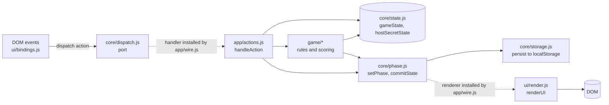

# Architecture

## Overview

A single-page app made of native ES modules. There is no bundler and no framework; `index.html` loads `js/main.js`, which imports everything else.

## Control flow



1. A DOM event calls `dispatch({ type, payload })`. `dispatch` lives in `core/dispatch.js` and only forwards to a handler.
2. The handler is `handleAction` in `app/actions.js` (a large `switch`), installed by `wireApp()` from `main.js`. It calls into `game/` for rules, mutates `gameState`, then calls `commitState()`.
3. `commitState()` (in `core/phase.js`) calls the installed renderer, `renderUI()`, which shows the screen for `gameState.phase`, and then persists the state.

Dotted arrows are the two injected links; everything else is a plain `import`.

Phases: `welcome → setup → reveal → timer → vote → (wager) → (guess) → result → leaderboard`. The timer can be re-entered when a caught spy leaves others in play.

## State model

| Object | Persisted | Purpose |
| :--- | :--- | :--- |
| `gameState` | yes | Everything visible to the table: phase, players, scores, settings, timer seconds. |
| `hostSecretState` | yes | Secrets only the host device holds: secret word, roles, votes cast, wagers. Serialised separately. |
| `session` | no | Ephemeral UI state (open role card, hand-off progress, pending confirmation). |

`gameState` and `hostSecretState` are exported `const` objects. Restoring a save uses `replaceGameState()` / `replaceHostSecrets()`, which swap the contents **in place**, so every module keeps a valid reference. Saves are versioned (`SAVE_VERSION`); a mismatch discards the save instead of loading incompatible data. A save also records the language of its match in `gameState.match.lang` (an optional field, so it did not need a new version; see [A match keeps its language](#a-match-keeps-its-language)). Likewise `settings.diff` (the difficulty levels) is an array of `'easy'`, `'medium'` and `'hard'`; a save from before the setup screen had one chip per level holds the string `'all'` or one level name there. `normalizeDifficulties()` in `core/config.js` reads both (and treats anything else as all three levels), so that change did not need a new version either, and `filterPoolByDifficulty()` in `game/rounds.js` applies it when a round's word pool is built.

The round-result screen is drawn from the state, not written once: `renderRoundResult` (`ui/results.js`) is the only code that writes `#result-title` and `#result-desc`, and it runs when the round resolves (`buildHostRoundResult`) and on every `renderUI` of the result phase, so a restored match shows the same screen. It reads the outcome from `gameState.round.result` (`{ winner, reason }`, an optional field set when the round resolves and removed by `startNextRound`; without it, as in a save made before it existed, nothing is drawn and the screen keeps the defaults of `index.html`) and everything else from what is saved anyway: the secret word (`hostSecretState`), the player voted out and the tie note (`gameState.vote`), the scores and the language of the match. The field holds only what the screen shows, and it does not exist during play, so no secret is saved that was not saved already. `SAVE_VERSION` was not bumped.

The countdown never compares wall-clock times. `gameState.timer.pausedSec` is decremented once per tick, so reloading, backgrounding, or pausing cannot make time jump.

### The saved setup

The plain setup options of the last match that was started are kept under `spy_setup_settings` as `{ version: 1, settings }` (`saveSetupSettings` / `loadSetupSettings` in `core/storage.js`), so the next visit starts from them instead of the defaults.

- **What is saved.** Exactly the keys of `defaultSetupSettings()` (`core/config.js`): players, spies, timer, categories, difficulty (an array of levels, as `settings.diff` holds it), reveal mode, hint types, the switches and the emergency-vote limit. Not saved: player names (`spy_saved_player_names`), custom words, language, theme, sound, `detectiveUsed`. `gameState.settings` itself starts from the same `defaultSetupSettings()`, so there is one list of defaults.
- **When.** At the end of `validateAndSaveSettings` (`ui/setup.js`), after the names are validated and saved, so a refused start writes nothing.
- **What is read is untrusted.** `sanitizeSetupSettings` is the one gate, for reading, writing and filling the form. Each field is judged alone and a bad one takes only its own default: numbers must be whole and are clamped to `RULES`; spies are clamped to `getMaxSpiesAllowed(players)` for the restored count; switches must be booleans; unknown category and hint ids are dropped (none left is the default list); difficulty goes through `normalizeDifficulties` (so the single string of older data is still read); unknown keys are ignored. A record that is not JSON, not `{ version: 1, settings }`, or a storage that throws gives `null`, and `null` means "leave the form as it is". A new format changes `SETUP_SETTINGS_VERSION`; a record of another version is ignored whole.
- **When it is put back.** `restoreSavedSetup` (`ui/setup.js`) runs in `start()` of `main.js` and after `setPhase('welcome')` in `RESET_MATCH`. It writes the form only (values, chips and their pressed look, the emergency-vote box, then the name inputs and hints follow the player count) and never `gameState`, and it does nothing while `isMatchInProgress()`. `RESTORE_GAME` does not call it, so a resumed match keeps the settings it was saved with and the saved setup stays for the next match.
- **Tests.** `tests/unit/setup-settings.test.mjs` (defaults against `index.html` and the word banks, the validator field by field, the record, the form, `RESTORE_GAME`, `RESET_MATCH`) and `tests/e2e/setup-memory.test.mjs` (reload, damaged record, blocked storage, resume, new match).

### The setup screen groups

Under the five core fields (players, spies, categories, difficulty, discussion timer, wrapped in `#setup-core`) the options of `#screen-setup` sit in four native `<details class="setup-group">` elements in `#setup-groups`: `roles` (hint types, detective, fellow spies, fool), `discussion` (turn director, one-word, quests, vote limit with `#vote-limit-box` right under its switch), `stakes` (wager, sudden death, spy last chance) and `speed` (card-reveal select, role-reveal confirmation, vote confirmation, quick voting). The player names, the start button and the back button follow them. This is markup and presentation only: the controls keep their ids and names, and `ui/setup.js`, the saved setup and the match settings read and write them by id, never through the groups. A closed `<details>` keeps its content in the DOM, so restoring a saved setup works while the groups are closed.

- **Open or closed** is the state of the `<details>` element and nothing else: the groups start closed, the browser handles click, Enter and Space, and the state lives for the visit only (no storage key, nothing in the saved setup or in a match).
- **Badges.** Each `<summary>` ends with a badge (`#setup-group-<id>-badge`) with the number of the group's controls that are on, written by `refreshSetupGroupBadges` in `ui/setupGroups.js` (`t('setup.group.badge', { n })` with `formatNumber`, so the language's wording and digits). A switch counts when ticked, each ticked hint chip counts one, the card-reveal select counts on `hold`; it is the plain state, not a comparison with the defaults. The `SETUP_GROUPS` table in that file is the one place that says what each badge counts. It is refreshed by the `change` listener on `#setup-groups` (`ui/bindings.js`), at the end of `applySetupSettingsToForm` (so for a restored setup and after `RESET_MATCH`), after the hint fallback in `validateAndSaveSettings`, in `start()` and in `refreshLanguageDependentUi` (`main.js`). The module imports only `i18n/index.js`.
- **Attention.** `pulseInvalidField` (`ui/feedback.js`) is the only code that focuses or scrolls to a setup field, and it opens every closed `<details>` around the field before it does, so an invalid emergency-vote number is on screen. The spies/players role-count message cannot be reached from the form (the spy maximum leaves room for both special roles), so it opens nothing.
- **Tests.** `tests/unit/setup-groups.test.mjs` (markup, the control-to-group table, catalogs, `countOn`, the badges, `pulseInvalidField`), `tests/e2e/setup-groups.test.mjs` (the same in Chromium at 360x740, plus keyboard, overflow in all themes, restore with closed groups, stored JSON). The e2e helper `tests/e2e/helpers/setupGroups.mjs` opens groups for the tests that tap a control. `recordScreen` (`tests/e2e/helpers/record.mjs`) opens the groups while it reads, leaves the headers out and puts the state back; the comparison with `persian-baseline.json` (never edited) keeps the head and tail of the setup text in order and compares the options between them as a multiset.

### Recently used words

A word never repeats inside one match: `gameState.match.usedWordKeys` holds the keys (`normalizeWord`) of the words drawn so far and `START_MATCH` clears it. To keep a new match from opening with last night's word, the keys of the last 300 chosen words are also kept across matches under `spy_recent_words` (a JSON array, newest last; `loadRecentWords` / `rememberRecentWord` in `core/storage.js`). It is not part of the saved match, so `SAVE_VERSION` is unchanged and a resumed match does not touch it.

- **When.** `startNextRound` (`game/rounds.js`) reads the list once to choose the word and writes the key of the chosen word right after (a key already in the list moves to the end, so it is there once; the list is cut to the newest 300).
- **The rule** is the pure `selectableWords(pool, usedKeys, recentKeys)`, where the pool is what the categories and the difficulty leave. (1) Words used in this match are never drawn; if that leaves none, the whole pool is available again and the used list starts over (as before; the recent list plays no part). (2) Otherwise recent words are left out too, but only while the words that are neither used in this match nor recent are at least half of the whole pool (`fresh * 2 >= pool.length`); with fewer the recent list is ignored and only (1) applies. Why: a pool of one category and one difficulty has 16 to 18 words, so 300 remembered words would cover all of it and leave nothing; with the half rule such a pool varies fully inside every match. The price is that a small pool is protected from last match's words only until half of it has been used or heard. The default Persian pool (2,147 words) is far larger than 2 x 300, so the list applies there for any realistic match. The default English pool (703 words) is only a little larger than 2 x 300: the list applies there for the first ~50 rounds of one match, then only rule (1) is left, which is the intended fallback and will matter less as the English bank grows.
- **Languages and custom words.** Keys are the texts of the words, so the Persian bank, the English bank and custom words share the one list without clashing (today no key is in both banks); the 300 places are shared by all of them.
- **What is read is untrusted.** Not an array: empty. In an array: entries that are not non-empty strings of at most 60 characters are skipped, a repeated key counts once at its newest place, and only the newest 300 are used. A storage that throws reads as empty and the write is skipped, so a round always gets its word.
- **Tests.** `tests/unit/recent-words.test.mjs` (the storage functions, the rule on plain arrays and seeded rounds across matches, in both languages).

## Modules

| Layer | Modules | Notes |
| :--- | :--- | :--- |
| `app/` | `actions`, `wire` | The action handler (the big `switch`) and the composition root. Only `wire` imports `actions`, and only `main.js` imports `wire`. |
| `core/` | `config`, `state`, `storage`, `phase`, `dispatch`, `buildInfo` | `config` is pure data plus pure functions (the limits, the difficulty helpers, and the defaults and validator of the saved setup). `buildInfo` is two stamped constants (version, hash) and imports nothing. `dispatch` is a port and `phase` holds `setPhase` and `commitState`; neither imports `game/`, `ui/` or `app/`. |
| `game/` | `timer`, `rounds`, `voting`, `resolution`, `ranking`, `questionPicker` | `ranking` and `questionPicker` are pure (`questionPicker` imports nothing). `timer`, `rounds`, `voting` and `resolution` read and write `gameState`; they are unit-tested against the fake browser in `tests/unit/helpers/`. |
| `ui/` | `render`, `results`, `setup`, `wheel`, `handoff`, `scorecard`, `customWords`, `bindings`, `feedback`, `focusTrap`, `langSwitch`, `theme`, `buildInfo`, `buildInfoReveal`, `questionIdea`, `setupGroups` | All DOM code lives here (plus `timer.js` for the countdown text). |
| `platform/` | `audio`, `wakeLock`, `antiZoom`, `install`, `installHint`, `serviceWorker` | Browser capabilities. `installHint` is pure (no imports, no DOM): it decides which install hint applies (see [Install hint](#install-hint)). |
| `i18n/` | `index`, `catalogs`, `fa`, `en` | Translation core and the Persian and English catalogs (see [Translations](#translations)). It imports nothing from `game/`, `ui/` or `app/`. |
| `js/` root | `main`, `preinit` | `main` is the module entry. `preinit` is a classic script loaded from `<head>` that is not part of the module graph (see [First paint in another language](#first-paint-in-another-language)). |
| `data/`, `utils/` | word banks, side quests and question ideas (one set per language, `data/banks.js` picks by language code), help-text keys; text and random helpers | `utils/` and `data/` are pure and unit-tested. `data/` imports nothing outside `data/` (the language is passed in as an argument, never read from `i18n/`). |

## Dependency direction

```text
main.js -> app/wire.js -> app/actions.js -> game/, ui/, platform/, data/, utils/, core/
game/, ui/ -> core/dispatch.js (port), core/phase.js, core/state.js, ...
core/dispatch.js, core/phase.js -> core/state.js, core/storage.js, core/config.js, platform/wakeLock.js, data/
core/, ui/, game/, platform/, app/, utils/text.js -> i18n/index.js (t, tn, tHtml, setTemplate, formatNumber, formatList, ...)
game/rounds.js -> data/banks.js (getWordPacks(lang), getSideQuests(lang)); data/ -> data/ only
ui/questionIdea.js -> game/questionPicker.js (pure, imports nothing), data/banks.js (getQuestionIdeas(lang))
i18n/index.js -> i18n/catalogs.js -> i18n/fa.js, i18n/en.js (nothing else)
```

Two things used to point upward from `core/` into `game/` and `ui/`, which is what made the cycles. Both are now injected by `app/wire.js` when the app starts:

| Seam | Lives in | Filled with | Why it is a seam |
| :--- | :--- | :--- | :--- |
| `dispatch(action)` | `core/dispatch.js` (`setDispatchHandler`) | `handleAction` from `app/actions.js` | The handler needs every module, and those modules need to dispatch. |
| `commitState()` renders | `core/phase.js` (`setRenderer`) | `renderUI` from `ui/render.js` | `commitState` and `setPhase` are called by `game/`, and rendering reads `game/`. |
| `setPhase()` pre-hook | `core/phase.js` (`setBeforePhaseChange`) | `stopTimerWhenLeavingTimerPhase` from `game/timer.js` | The timer calls `setPhase`, and `setPhase` has to stop the timer when leaving the timer screen. |

The seams are plain synchronous callbacks rather than `EventTarget` events on purpose: calls stay re-entrant (an action can dispatch another action) and an exception still reaches the caller, exactly as with a direct call. An unconnected seam throws instead of doing nothing, so a forgotten `wireApp()` fails loudly.

`tests/unit/import-cycles.test.mjs` reads every `import` under `js/` and fails on any cycle, on an import of a missing file, and on `core/` or `i18n/` importing from `game/`, `ui/` or `app/`. `tests/unit/phase.test.mjs` covers the seams themselves. The game rules in `game/` are covered by `rounds`, `voting`, `resolution` and `timer` tests that pin current behaviour; they load the modules after `tests/unit/helpers/fakeEnv.mjs` has installed a minimal `window`, `document`, `localStorage` and a manual clock. Rendering, the wheel animation, sound and the full game flow in a real browser are not covered by unit tests.

## Translations

**Every text a player can see comes from `t(key)` (in JS) or from a `data-i18n` attribute (in `index.html`).** The catalogs in `js/i18n/` hold the texts; `fa.js` is the Persian one and the last fallback, `en.js` is the English one.

- **Catalog:** a flat object of dotted English keys grouped by screen (`setup.title`, `info.detective.text`). Values are plain text with optional `{name}` parameters, never HTML. `catalogs.js` lists every catalog, and the tests walk that list.
- **Tools.** `tn(key, count, params)` picks `key.one` / `key.other` (or the other plural categories) by `Intl.PluralRules` of the active language and fills `{count}` with `formatNumber(count)`; Persian has the same text in both forms. `formatNumber(n)` writes the digits of the language (table `NUMERALS`, next to `LANG_DIRECTIONS`). `formatDuration(seconds)` uses `time.minutes.*`, `time.seconds.*` and `time.minutesAndSeconds`, so the language decides the wording and the order. `formatList(items)` (and `formatListHtml(items)` for items that are already safe HTML, such as a name in `<bdi>`) writes "A, B and C": two items use `names.pair`, three or more chain `names.list.separator` and finish with `names.list.last`, each a `{a}` / `{b}` template, so the language decides the separator and the last word (English "A, B and C", Persian "A و B و C"). It is catalog-driven on purpose, not `Intl.ListFormat`, so Persian stays exactly what it was. `setTemplate(element, key, slots, params)` writes one whole sentence into an element without `innerHTML`: each `{name}` is replaced by a node or a string from `slots`, the rest is text, `{br}` is a line break. `tHtml` / `tnHtml` do the same for an HTML string, escaping the catalog text and every parameter except one wrapped in `rawHtml()`.
- **No Persian in the code.** A sentence that holds a name or a number is one template (`{name}`, `{count}`); the markup around a name stays in the code and the catalog never has any. `tests/unit/no-hardcoded-text.test.mjs` fails on any Persian letter, digit or comment under `js/` except `data/`, `i18n/` and a short, commented list of input-normalisation lines in `utils/text.js`.
- **`t(key, params)`** looks in the active language, then in Persian, then returns the key itself. It never interprets HTML and never escapes anything: put its result (or a parameter) into `innerHTML` only after `escapeHtml`. `textContent` needs no escaping.
- **Static HTML keeps its Persian text.** The text written in `index.html` is the default, so the first paint, the offline path and the Persian experience never wait for JS. An element gets `data-i18n="key"` (replaces its whole `textContent`, so leaf elements only; if the text sits next to other children, wrap it in `<span data-i18n="key">`) or `data-i18n-attr="aria-label:key;placeholder:key"` for attributes. `<title>` and `<meta name="description">` use the same attributes.
- **Start-up and switching.** `initI18n()` runs first in `main.js`: it reads the saved language (`localStorage` key `spy_lang`) and translates the static HTML only if that language is not the default. Before that, for a saved language that is not the default, `js/preinit.js` has already set `<html lang dir>` and a class that hides the page until `initI18n()` is done (see [First paint in another language](#first-paint-in-another-language)). `setLang(lang)` ignores an unsupported language; otherwise it saves the choice, sets `<html lang dir>`, translates the static HTML (always, so going back to Persian works) and tells the `onLangChange` listeners.
- **Elements JS writes.** Some elements in `index.html` have Persian default text that JS overwrites on every use (the hand-over gate, the role card, the result title, the elimination reveal, and so on). They carry no `data-i18n`; JS writes their texts from the catalog (and a sentence with a name is one element that `setTemplate` fills). `tests/unit/i18n-html.test.mjs` keeps that list explicit (`JS_WRITTEN`, with the catalog keys each element receives, and which default equals which text) and fails on any other Persian text in `index.html` that is not translatable.

`tests/unit/i18n-format.test.mjs` covers the tools above (plurals, digits, durations, templates, the HTML variants, with a fake second language). `tests/unit/i18n.test.mjs` covers `t`, the fallback chain, `setLang`, `initI18n` and the static translator. `tests/unit/i18n-html.test.mjs` checks that every key in the HTML exists, that the Persian text in `index.html` equals the catalog value (so the two sources cannot drift apart), that all catalogs have the same keys and placeholders, and that no catalog key is unused.

### Direction (LTR / RTL) and locale

The direction comes from the language (`LANG_DIRECTIONS`, written to `<html dir>` by `setLang`). CSS reads it from `<html dir>`; JS asks `getDirection()`; `Intl` and dates ask `getLocale()` / `formatDate()` (`LANG_LOCALES`). Nothing in the code assumes a side.

- **CSS uses logical properties.** `text-align: start`, `margin-inline-*`, `padding-inline`, `inset-inline-*`; flex and grid already follow the direction. An offset that must flip is written `calc(Npx * var(--dir))` (`--dir` is `1` on `:root` and `-1` under `:root[dir="rtl"]`): the toggle knob, the pass-the-phone icon, the ambient glow drift. A layout that must differ per direction gets a `:root[dir="rtl"]` override (the podium order; silver, gold, bronze reads left to right in both; the two floating buttons, whose inline edge swaps sides, read the safe-area inset of the physical side they are on). `tests/unit/css-direction.test.mjs` fails on any physical left/right declaration that is not on its short, commented allow-list (safe-area insets, the play triangle, the centred toast), so a new rule cannot reintroduce one.
- **Player names are user text in either script,** so a name never sits next to text without isolation: in an HTML string wrap it in `<bdi>`; an element that holds only a name (a field, a card, a title, an inline `<strong>`) gets `unicode-bidi: plaintext` (see the rule in `style.css`); in a plain-text sentence wrap it with `isolate(name)` (U+2068 ... U+2069). Do not use `plaintext` on a table cell or a heading: an element with no letter of its own (a cell that holds just a `<bdi>`) is resolved as LTR by Chrome, which flips its alignment. `<bdi>` keeps the page direction there.
- **The scorecard canvas** takes the direction from `getDirection()`: `ctx.direction`; the columns of the "other players" rows (`computeRestRowColumns(layout, direction)`, pure, exactly mirrored for LTR); the bidi marks (`isolateLine`: RLI for RTL, which is what the Persian image always used, LRI for LTR, one per line, plus `isolate()` per name; `balanceIsolates` closes a name that a line wrap or an ellipsis cut); and the date (`formatDate`). The podium and all centred text are direction-neutral. **Who is drawn where** is decided by `buildScorecardRows(groups)` in `ui/scorecard-layout.js` (pure, no canvas): a podium slot (rank 1-3) names at most two players ("A and B (tied)"), and for a bigger tie it writes "A and N others (tied)" and names only the first, so the other N players are the first rows of the "other players" list, ahead of the rank 4+ rows (they outrank them), each with its real rank number and the tied marker. Every player is in the image exactly once, as a podium name or as a row; the podium text reads the same `named` players, so the slot and the list cannot disagree. A row's name is cut before the measured score (`computeRestNameMaxWidth`) and a podium line to its slot (`wrapCanvasText`). The canvas stays 720x1280 whatever the tie shape: the longest list the game can make is 19 rows (20 players all tied for 1st), which the scale (0.71) absorbs. Pure layout functions get the direction as an argument.
- **Digits.** `formatNumber` follows `NUMERALS`. A few Persian places keep Latin digits on purpose (they pass `{count}` or the value as text themselves); English is Latin everywhere.
- **Not covered by a language yet:** `manifest.json` (`lang`, `dir`) and the `og:*` and Twitter meta tags in `index.html` (crawlers do not run JS, so they stay Persian).

### A match keeps its language

A running match stores texts in the language it was started in (the role hint titles and hints, the category label, the detective's answer), and its secret word comes from that language's word bank. So **the language must not change under a match.**

- `startNextRound` writes `getLang()` into `gameState.match.lang`; the save (`persist`) carries it.
- `RESTORE_GAME` (in `app/actions.js`) reads it with `normalizeLang()` and calls `setLang()` **before** `replaceGameState` and the first render, so the restored game and the UI agree. A save with no `match.lang` (every save made before it existed) is Persian; an unsupported or malformed value is ignored the same way. A save that is rejected (another `SAVE_VERSION`) leaves the language alone. `SAVE_VERSION` was not bumped: the field is optional and old saves restore unchanged.
- `setLang` also saves the choice under `spy_lang`, so restoring a match in a language other than the saved preference makes that language the preference. That is deliberate: there is one stored value, no separate "preferred" one, and the language switch changes it too.
- **The language can only change outside a match** (see [The language switch](#the-language-switch)). `startNextRound` uses the active language for the next round, so a switch mid-match would mix languages inside one match.
- `main.js` listens with `onLangChange` and redraws what JS writes only once (see [The language switch](#the-language-switch)).

**Stored text that must not freeze in one language.** Two kinds of user data hold a default that a language wrote:

- *Player names* (`spy_saved_player_names`). A name that is just the default of a slot in ANY supported language is not saved (`''` is saved, so the slot keeps its place) and is read as "no saved name" when loaded (`isDefaultPlayerName` in `core/storage.js`, built from `setup.player.default` with `{n}` as any number). A typed name is kept as is. The check does not compare the number with the slot, so a language's `setup.player.default` must keep its `{n}`.
- *Custom words.* No hint is stored as `''`. `displayHint()` words an empty hint, or a legacy stored one equal to `setup.hint.none` of any language, in the active language when it is shown or put on a role card.

### The language switch

A person changes the language with two buttons on the **welcome screen only** (not in the header, which is on every screen). Where each part lives:

| Part | File | What it does |
| :--- | :--- | :--- |
| Markup | `index.html` (`#screen-welcome`) | A `role="group"` (named by `welcome.lang.aria`) in a `dir="ltr"` wrapper, so the buttons keep the same visual order in both languages. One `button.lang-btn` per language with `id="btn-lang-<code>"`, `lang="<code>"`, `data-lang="<code>"` and `aria-pressed`. The labels ("فارسی", "English") are fixed text in their own language: no `data-i18n`, no catalog key. The page is Persian before JS runs, so only the Persian button starts pressed. |
| Style | `css/style.css` (`.lang-switch`, `.lang-btn`) | Logical properties only. The selected look is drawn from `[aria-pressed="true"]`, so what is shown and what a screen reader announces cannot disagree, and from the theme tokens (a fill of `--brand-primary` in `--surface-input`, a `--brand-primary` border and glow, the label in `--text-primary`), so it follows the selected theme (see [Themes and colours](#themes-and-colours)). Buttons are 44 px high. |
| Click | `ui/bindings.js` | `dispatch({ type: 'SET_LANG', payload: btn.dataset.lang })`, nothing else. |
| Action | `app/actions.js` (`SET_LANG`) | Ignores an unsupported value (`normalizeLang(value) !== value`, so `undefined`, an array, `'de'` and `'__proto__'` are ignored), ignores a request while `isMatchInProgress()` is true, ignores the language that is already active, otherwise calls `setLang`. It does not call `commitState`: nothing about the match changes. |
| Rule | `core/phase.js` (`isMatchInProgress`) | True in every phase except `welcome` and `setup`, an unknown phase included, and the final scoreboard too. The welcome screen with the recovery banner is not in progress, so the language can be changed there; **Resume match** then switches back to the language of the saved match (`RESTORE_GAME`). |
| Refresh | `main.js` (`refreshLanguageDependentUi`, an `onLangChange` listener) | `setLang` has already translated the static HTML (`data-i18n`, `data-i18n-attr`, `<title>`, the meta description, `<html lang dir>`, the theme options, the chips, the toggles, the recovery banner, the words modal's static texts). The listener redraws what JS writes only once: the pressed state of the switch (`syncLangSwitch` in `ui/langSwitch.js`), toasts on screen (`clearToasts`), the limit hints, the "N on" badges of the setup groups (`refreshSetupGroupBadges`), the name inputs (`renderNameInputs(false, true)`, which updates the existing inputs in place), the custom-word count and list, and the shown question idea (cleared, see [Question ideas](#question-ideas)). Because it listens to the language and not to the click, a language change that comes from restoring a match is covered too. |

Texts that are built when something opens (the info modals, the confirmation dialog, the role card, every screen after `renderUI`) read `t()` at that moment and need no refresh. A name the user typed is never changed; a slot that still holds the other language's default ("بازیکن 3" / "Player 3") gets the new default and keeps its player id.

`renderNameInputs` (`ui/setup.js`) **updates the inputs in place**: it keeps the existing elements, their values and their player ids, adds or removes only the slots at the end, and writes a value only when it changes. This is not only tidiness: the player-count field's `change` event fires when it loses focus, which on a phone is the moment the person taps a name input, and an implementation that redrew every input there deleted the tapped element, so the first tap focused nothing (`tests/e2e/lang-switch.test.mjs` taps with a mouse and with touch).

**A new language appears in the switch** when its button is added to the group in `index.html`: copy one `button.lang-btn`, change `id`, `lang`, `data-lang` and the label (the name of the language in itself), keep `aria-pressed="false"`, and list it in `FIXED_TEXT` in `tests/unit/i18n-html.test.mjs`, which also checks that there is exactly one button per entry of `SUPPORTED_LANGS`, in the same order. The buttons share the row (`flex: 1`), so a third one fits as it is; a long label may need a wrapping row in `css/style.css`. Everything else (catalog, direction, locale, word bank) is in [Adding a language](#adding-a-language).

#### First paint in another language

`index.html` is Persian, and the module graph takes a moment to arrive, so a person who chose English would first see the whole page in Persian, right to left (measured: about 400 ms on a local connection, longer on a slow one). `js/preinit.js` prevents that. It is a **classic script** (not a module, and not part of the module graph), loaded from `<head>` after the CSP and before the stylesheet, so it runs before the first paint. When `spy_lang` holds a supported language other than Persian it writes `<html lang dir>` and puts the class `i18n-pending` on `<html>`. `css/style.css` keeps `body` hidden while that class is there (the page background still shows, because it belongs to the canvas), and `initI18n()` removes the class after translating the static HTML, also when translating throws.

- **Safety net, no JS involved.** The same CSS rule has a zero-duration animation with a one-second delay that sets `visibility: visible`. If the class is still there after a second (`main.js` failed to load, or threw), the page appears anyway, so a JS failure can never leave a blank page.
- **The Persian path is untouched.** Persian, no saved language, an unsupported value, and a `localStorage` that throws or is missing do nothing in `preinit.js`: no class, nothing hidden, the same first paint as before.
- **It repeats two things it cannot import:** the direction table (`LANG_DIRECTIONS`) and the class name (`PAGE_PENDING_CLASS`). `tests/unit/preinit.test.mjs` runs the shipped file against every entry of `SUPPORTED_LANGS` and `LANG_DIRECTIONS`, so a language added in one place and not the other fails there; a new language needs a line in its table.
- `tests/e2e/first-paint.test.mjs` holds `main.js` back in a real browser and checks that the page is hidden and `<html>` is already English and LTR, that the page shows after `initI18n`, that the CSS alone shows it after about a second when `main.js` cannot load or throws, and that a Persian user sees the page at once.

### The English word bank

`js/data/wordPacksEn.js` holds 703 words: the same 8 category ids as the Persian bank, one array per category, entries written `{ word, foolWord, hint, diff }` one per line. A citizen gets `word`, the optional fool gets `foolWord` and believes it is the real word, a spy gets only the `hint` (or the category, the first letter, or nothing). Every entry is written by hand.

Rules checked by `tests/unit/data.test.mjs` (English block):

- `word` and `foolWord`: sentence case, 1 to 3 words, at most 30 characters, letters, digits, spaces and a few marks, no leading article. `hint`: one capitalised word, at most 30 characters. `word` is unique in the whole bank.
- Neither the hint nor the foolWord contains the word or is contained in it, also after dropping a trailing -s, -es, -ing or -ed. The hint never starts with the same 4 letters as a word of its entry (hair / haircut). The foolWord is never the hint.
- No hint is used by more than `EN_MAX_HINT_REUSE` (4) entries in the whole bank; today every hint is used once.
- Size: `EN_MIN_WORDS_BY_CATEGORY` (60 per finished category), `EN_MIN_BY_DIFFICULTY` (20 easy, 16 medium, 16 hard per finished category) and `EN_MIN_WORDS_TOTAL` (650, applied once every category is finished). All four constants sit at the top of the English block, so raising a floor is a one-number change. A category added later and not yet written keeps the seed floors (`EN_SEED_MIN_WORDS`, `EN_SEED_MIN_BY_DIFFICULTY`), which keeps the project green while it grows.
- `tests/unit/rounds.test.mjs` checks, for every category and difficulty, that an English match draws a word from that category and difficulty with its own foolWord and hint.

What no test can see is checked by hand when a word is added: two entries naming the same thing, a foolWord that is a synonym or too far from the word, brands, regional words, content (no alcohol, violence, disasters, religious holidays or politics) and whether `diff` matches the hint (easy: the hint points almost straight at the word; hard: it fits many words).

### Adding a language

1. **Catalog.** Copy `js/i18n/en.js` to `js/i18n/<code>.js` and translate every value (including `names.pair`, `names.list.separator` and `names.list.last`). `setup.player.default` must keep `{n}` and `setup.hint.none` is the text legacy custom words are recognised by (see [A match keeps its language](#a-match-keeps-its-language)). Keep every key, every `{placeholder}` and every emoji; values stay plain text; every plural text needs `.one` and `.other` plus whatever other categories `Intl.PluralRules('<code>')` can return. Put a glossary comment at the top: one term per game idea, used everywhere (the English file is the model). Write for the language, not word for word: placeholders may move where the sentence needs them.
2. **Registry, direction and locale.** Import the catalog in `js/i18n/catalogs.js`, add the code to `SUPPORTED_LANGS`, its direction (`'rtl'` or `'ltr'`) to `LANG_DIRECTIONS` and its locale tag (`fa-IR`, `en-US`) to `LANG_LOCALES` in `js/i18n/index.js`. A language that writes its own digits also gets an entry in `NUMERALS`; one whose dates need options (a spelled-out month) gets an entry in `DATE_OPTIONS`.
3. **Word bank and side quests.** Copy `js/data/wordPacksEn.js` to `js/data/wordPacks<Code>.js` (the same 8 category ids, entries `{ word, foolWord, hint, diff }`, one array per category) and `js/data/sideQuestsEn.js` to `js/data/sideQuests<Code>.js` (one sentence per quest), then list both in `WORD_BANKS` and `QUEST_POOLS` in `js/data/banks.js`. A language with no entry there plays with the Persian words and quests. `data/` never imports `i18n/`: `rounds.js` passes `getLang()` in. The per-language rules in `tests/unit/data.test.mjs` (same categories, shape, length limits, no duplicates) run for every language in `DATA_LANGS` by themselves; add the language-specific ones (script, minimum counts as named constants) next to the English block. The English block is the model; see [The English word bank](#the-english-word-bank). If the "all categories" label states a number, it must be that bank's size rounded down to a hundred, or leave the number out until the bank is that big.
4. **Build.** Nothing to do: `scripts/build.mjs` copies all of `js/` and puts every file in the service-worker precache, so the new catalog and data are available offline after the first visit.
5. **Tests.** The parity tests (`i18n-html.test.mjs`) walk `CATALOGS`, so a missing key or a changed placeholder fails at once. Copy `tests/unit/i18n-en.test.mjs` for the language-specific checks (script, plurals, digits, direction). A language that does not put "and" between the last two names needs its own `names.list.*` templates (and a test like `tests/unit/i18n-list.test.mjs`).
6. **Switch button.** Add the language's button to the switch on the welcome screen (see [The language switch](#the-language-switch)) and list it in `FIXED_TEXT` in `tests/unit/i18n-html.test.mjs`; without it nobody can choose the language in the UI.

## Themes and colours

- **Where the themes are.** `css/style.css` defines the tokens in `:root` (the default theme) and in seven `body[data-theme="..."]` blocks (noir, classic, emerald, crimson, sunset, cyber, ocean). Every theme sets nine tokens: `--bg-body`, `--bg-gradient`, `--surface-card`, `--surface-input`, `--border-glow`, `--text-primary`, `--text-secondary`, `--brand-primary`, `--brand-secondary`. `--brand-emerald`, `--brand-rose` and `--brand-amber` are meaning colours: only `:root` sets them and no theme may change them. All themes are dark (`color-scheme: dark`).
- **What follows the theme.** Every rule outside the theme blocks is written with those tokens: buttons (the main button and the play button are `--brand-primary` and `--brand-secondary` mixed 45% into `--bg-body` with `--text-primary` on top, which keeps the label at 4.5:1 or more in all eight themes), chips, switches, cards, panels, scrims, thin lines and the language switch. Translucent fills are `color-mix(in srgb, <token> N%, transparent)`; a rule that needs to look right in a browser without `color-mix` writes a plain token first.
- **What stays the same in every theme, and why.** The emerald, rose and amber buttons and badges (go, danger, caution), the red of the "hard" chip and of the error pulse, the gold, silver and bronze of the podium, the violet accolade (one of five hues that tell the accolade cards apart), black depth shadows, the black cover-mode screen, and the wheel (a multi-colour palette with light labels and a red needle). They are the only fixed colours left in the stylesheet, each on the allow-list in `tests/unit/theme-colors.test.mjs` with its reason. Outside the stylesheet a colour may only be written in `js/ui/scorecard.js`, `js/ui/wheel.js` and `js/core/config.js`.
- **Things that cannot read the CSS.** The scorecard canvas keeps a table (`SCORECARD_THEME_ACCENTS`) that mirrors the tokens of each theme (brand colours, text colours, the colour of `--surface-card`) plus two background stops that have no token; `THEME_COLORS` in `core/config.js` is `--bg-body` per theme for `<meta name="theme-color">`; `index.html` and `manifest.json` carry the default theme's colour because they cannot change at run time. Tests compare each of them with the stylesheet, so a theme added or changed in one place and not the others fails.
- **Adding a theme.** Add a `body[data-theme]` block with the nine tokens, an `<option>` in `#theme-selector` (and its `theme.*` catalog keys), an entry in `THEME_COLORS` and in `SCORECARD_THEME_ACCENTS`. `tests/unit/theme-colors.test.mjs` lists the eight theme names: add the new one there too, and its e2e twin, which reads the computed colours in every theme.
- **Tests.** `tests/unit/theme-colors.test.mjs` (the guard: no fixed colour outside the allow-list, tokens complete, semantic tokens untouched, contrast of the buttons' mix), `tests/unit/scorecard-colors.test.mjs` (the image drawn in every theme on a recording canvas), `tests/e2e/theme-colors.test.mjs` (computed colours in Chromium in every theme and both languages, with contrast). The CSS reader is `tests/unit/helpers/cssTokens.mjs`; the browser probe is `tests/e2e/helpers/themeProbe.mjs`.

## Service worker

See the README section on offline-first updates. In short: `scripts/build.mjs` hashes all shipped files and the `package.json` version into `sw.js`; the worker precaches them (bypassing the HTTP cache), serves them cache-first, and deletes older caches on activate. Cross-origin Google Fonts use a separate stale-while-revalidate cache that survives updates.

### Build line

The welcome screen can show which build is running: `v<package.json version> · <first 7 characters of the build hash>`, or `dev` in a source checkout. The line is hidden by default and a long press on the welcome title reveals it for 6 seconds (see "The reveal" below); it exists for diagnosing a stale installed PWA, not for players. One source of truth: `scripts/build.mjs` stamps the `version` of `package.json` and the hash it stamps into `sw.js` as `VERSION` into `js/core/buildInfo.js` (placeholders `__APP_VERSION__` and `__BUILD_HASH__`, replaced like those of `sw.js`). The file sits in `core/` because it is pure data with no imports; `ui/buildInfo.js` (`formatBuildInfo`, `renderBuildInfo`) turns it into text and `main.js` calls it once at start-up, followed by `initBuildInfoReveal()`. The page never fetches `package.json` and runs no inline script.

- **No circular hash.** `buildInfo.js` is hashed with its placeholders, exactly like `sw.js`; both are stamped after the hash is computed.
- **The version is in the hash.** `package.json` is not a shipped file, so the build adds its `version` to the hash input on its own. Bumping only the version therefore gives a new hash, a new service worker and a new cache, which is how installed users receive the new number. The same sources still give the same hash.
- **Dev detection** is `sw.js`'s: a hash that still starts with `__` means nothing was stamped, and the line says `dev`.
- **Markup.** `<p id="build-info" class="credit-line build-info hidden" dir="ltr" translate="no">` inside `#screen-welcome`, empty in `index.html` (so there is no Persian text for the translator or `i18n-html.test.mjs` to see, and no entry in `JS_WRITTEN`). The project's `.hidden` class (`display: none !important`) is in the markup, so the line is not drawn even on the first paint, takes no room and is not in the accessibility tree; it is not `aria-hidden`, because once revealed it is real information that a screen-reader user needs as much as anyone, for example to report a problem. The text is written at start-up whether or not the line is shown. The `.build-info` rules (`css/style.css`) only close the gap to the credit line above and add a 24px bottom margin, so a short screen scrolled to the end keeps the revealed line clear of the fixed cover-mode and install buttons. The `<h1>` of the welcome screen has the id `welcome-title`, the one element that listens for the press.
- **The reveal.** `ui/buildInfoReveal.js` is a pure controller (`createBuildInfoReveal`: no DOM, no imports, timers and the `show` / `hide` effects injected). A press is `pressStart(x, y)`; held for `HOLD_MS` (600 ms) it reveals the line, and the line hides itself `VISIBLE_MS` (6000 ms) after it appeared. `pressEnd` (release), `cancelPress` (`pointercancel`, `pointerleave`) and a `pressMove` of more than `MOVE_TOLERANCE_PX` (10 px, measured from where the press began) end the press without a reveal, so a quick tap and a scroll do nothing. A second long press while the line shows restarts the 6 seconds; it does not hide the line. `reset()` (the welcome screen was hidden) ends a press and hides the line at once; `destroy()` also stops the controller. `initBuildInfoReveal()` in `ui/buildInfo.js` is the only DOM code: pointer listeners on `#welcome-title` and nowhere else (a primary pointer with the main button, so touch, pen and the left mouse button), the `hidden` class as the reveal (no inline style: strict CSP), a `contextmenu` listener on the title that cancels the menu only while a press is held, and a `MutationObserver` on the class of `#screen-welcome` that calls `reset()` when `renderUI` hides the screen. `#welcome-title` has `user-select: none` and `-webkit-touch-callout: none`; no other element's touch behaviour is changed.
- **Tests.** `build-stamp.test.mjs` runs the real build on temp copies, `build-info.test.mjs` covers the text and the markup, `build-info-reveal.test.mjs` the controller (manual clock), the wiring (fake browser) and the markup and CSS the reveal relies on, `tests/e2e/build-info.test.mjs` the built site (also offline), the dev server, the themes and the geometry (it shows the line without the gesture), and `tests/e2e/build-info-reveal.test.mjs` the gesture itself in a real Chromium (mouse, touch, pen; Playwright's page clock, paused, so the 600 ms and 6000 ms boundaries are exact). `tests/e2e/helpers/record.mjs` leaves the line out of the Persian-text recordings, hidden or revealed.

## Install hint

The install button (`#btn-install-app`) only appears when the browser fires `beforeinstallprompt`, which is Chromium. iPhone and iPad (Safari and the other iOS browsers, all WebKit) install from the Share menu and Firefox for Android from its menu, and neither fires the event, so the welcome screen shows a one-line, closable hint for them (`#install-hint`, the first element of `#screen-welcome`). The hint has three cases, one line each: iOS ("Share, then Add to Home Screen"), iOS inside another app's built-in browser ("To install, open this page in Safari") and Firefox for Android ("Menu, then Install / Add to Home screen").

- **The decision is pure.** `detectInstallHint({ userAgent, platform, maxTouchPoints, standalone, beforeInstallPromptFired })` in `platform/installHint.js` returns `'ios'`, `'ios-in-app'`, `'firefox-android'` or `null`. iOS is an `iPhone`, `iPad` or `iPod` user agent, or an iPadOS in its default desktop mode (it reports as a Mac: `MacIntel` or `Macintosh` with more than one touch point, which a real Mac does not have). On iOS the answer is `'ios-in-app'` when the user agent looks like an app's built-in browser, else `'ios'`. Firefox Android is `Android` plus `Firefox/`. Already installed (`display-mode: standalone` or `navigator.standalone`) and "the install button is available" (`beforeinstallprompt` fired) both give `null`, before anything else is looked at.
- **The wiring** is `initInstallPrompt()` in `platform/install.js` (called from `main.js` as before): it reads the browser, asks the function, and toggles the `hidden` class of the box and of the line for the answer (`#install-hint-ios`, `#install-hint-ios-in-app` or `#install-hint-firefox-android`, so exactly one line is shown, or none; the lines and the box carry `hidden` in `index.html`). `beforeinstallprompt` asks again with the flag set, so a hint that is showing goes away when the install button appears.
- **In-app browsers are a heuristic from the user agent, and it has not been verified on a real device** (it was written and tested against user agents of the shapes these apps are known to send, in a desktop Chromium with the user agent replaced). It is deliberately conservative: when it is not sure the answer is the normal `'ios'` hint, never `'ios-in-app'`. A user agent counts as an app's WebView when ANY of these holds: (a) it has a known app token as a whole, case-sensitive token (`Instagram`, `FBAN`, `FBAV`, `FB_IAB`, `FBIOS`, `Line/`, `Twitter`, `Snapchat`, `MicroMessenger`, `TikTok`, `musical_ly`, `BytedanceWebview`, `WhatsApp`, `Telegram`); or (b) it is an iPhone or iPod user agent with no `Safari/` token (Safari and the full iOS browsers Chrome `CriOS`, Firefox `FxiOS`, Edge `EdgiOS` and Opera `OPiOS` carry it; WebViews usually do not). Rule (b) is not applied to an iPad in desktop mode (a `Macintosh` user agent has no iPhone or iPod token and never the app tokens, so only (a) can tell it) nor to an `iPad;` user agent. Known limits: the installed home-screen app and a bare WebView send the same user agent, so `standalone` is checked first and must stay first; an app that opens links in `SFSafariViewController`, or a WebView that sends a full Safari user agent and no known token, is not recognised and gets the normal iOS hint; an app that is not in the list is only caught by rule (b).
- **Dismissal** is the `localStorage` key `spy_install_hint_dismissed` (`'true'`), read and written in `try`/`catch`; the choice is also kept in memory, so a storage that throws still hides the hint for the visit. It is not part of the saved match and nothing else reads it.
- **Welcome screen only**, structurally: the box is inside `#screen-welcome`, so it is shown and hidden with that screen and has no phase logic of its own. Texts are static (`data-i18n`, `data-i18n-attr` on the close button), so the language switch needs no code for it.
- **Tests and the recorder.** `tests/e2e/helpers/record.mjs` leaves `.install-hint` out of a recording like the language switch (its close button's `aria-label` is in the page even when the hint is hidden, and the Persian baseline predates it).

## How to play help

A first-time player gets a short summary of a round from a button on the welcome screen (`#btn-how-to-play`, label `welcome.howToPlay`: «چطور بازی کنیم؟» / "How to play"), a small ghost pill inside the play button group under the caption, so the round play button stays the main action.

- **It is an info modal, not a new one.** The button carries `data-info="howToPlay"`, `howToPlay` is an entry of `INFO_KEYS` (`data/infoTexts.js`) and the texts are `info.howToPlay.title` / `info.howToPlay.text` in both catalogs. `ui/bindings.js` wires every element with `data-info` (the (i) buttons and this one) to `showInfoModal` in `core/dispatch.js`, which writes the texts with `t()` when it opens, so the language switch needs no code for it. The focus trap (`ui/focusTrap.js`), the close button and the focus returning to the button that opened it (`OPEN_MODAL` / `CLOSE_MODAL` in `app/actions.js`) are the ones every help modal uses.
- **Content.** About six short bullet lines, written for each language: who sees the word and who only a hint, the turns of questions without saying the word, the vote, the caught spy's last chance, how the spy wins. It does not describe wagers, side quests or scoring (they have their own (i) help), and it keeps the glossary at the top of `i18n/en.js`.
- **Tests and the recorder.** `tests/unit/how-to-play.test.mjs` (catalog entries, `INFO_KEYS`, the markup, `showInfoModal`) and `tests/e2e/how-to-play.test.mjs` (layout at 360x740, opening, the focus trap, the focus coming back). `tests/e2e/helpers/record.mjs` leaves `#btn-how-to-play` out of a recording like the language switch and the install hint: the Persian baseline predates the button.

## Question ideas

The discussion screen (`#screen-timer`) has a small ghost button, `#btn-question-idea` (label `timer.idea.button`: «ایده‌ی سؤال» / "Question idea", a 44 px target), under the timer card. Each press writes one suggested question, as plain text, into `#question-idea-text`, a polite live region (`aria-live="polite"`, `aria-atomic="true"`, always rendered and empty until the first press, so a screen reader announces what is written into it). The button is not redrawn, so it keeps the focus. The screen is public: the question is the same for every player and the code reads nothing about the match, so it can never show who the spy is or what the word is.

- **Where things live.** The banks are two plain arrays in `data/`, `questionIdeas.js` (Persian, spoken register) and `questionIdeasEn.js` (English), each written for its language, about 50 questions, read with `getQuestionIdeas(lang)` in `data/banks.js` (a language with no bank gets the Persian one, like the word banks). The picker is `createQuestionPicker({ getBank, random })` in `game/questionPicker.js`: pure (no DOM, no storage, no imports), the bank getter and the random function are injected, so tests seed both. `ui/questionIdea.js` is the only DOM code (`showQuestionIdea`, `clearQuestionIdea`): it owns the one picker of the page, asks it for `getLang()`'s bank and writes the result with `textContent`. The click is `dispatch({ type: 'SHOW_QUESTION_IDEA' })` (ignored outside the `timer` phase); it calls no `commitState`, so nothing is redrawn or saved.
- **The bag.** One shuffled bag per language. A press takes the next question; a question never comes twice before the bank is used up; when the bag is empty it is refilled, and if the new order would open with the question that closed the last cycle, that question is swapped with another place, so the same question is never shown twice in a row. Each language keeps its own bag, so a language change takes the new bank from the next press on and switching back goes on with the old bag.
- **Why the bag is in memory only.** The bag is a convenience for one sitting, not game state. Keeping it out of `localStorage`, `gameState`, `hostSecretState` and `session` means the saved match, its `SAVE_VERSION` and a resumed match are exactly what they were, there is no new key to read back untrusted, and a reload simply starts the bags over. The shown question is not stored anywhere either: it is the text of the live region.
- **When the question is cleared.** At the start of a round or a match (`NEXT_ROUND` and `START_MATCH` in `app/actions.js`, after the round has really started) and when the language changes (`refreshLanguageDependentUi` in `main.js`). On a language change it is cleared, not translated: the banks are not translations of each other, and the match keeps its language anyway (the switch exists on the welcome screen only; a restored match changes the language through `RESTORE_GAME`, which the same listener covers). A vote that is called off returns to the same discussion and keeps it. The bag is not reset by any of these.
- **What every question must satisfy** (checked by `tests/unit/question-ideas.test.mjs`): at least 40 distinct, trimmed, plain-text entries per bank, at most 80 characters, no duplicate, a mix of open and yes/no questions, no category name and no "word" or "spy", no secret word or decoy word of the built-in banks as a whole word (both languages), and Persian letters only in `data/`. They fit any word of any category on purpose; the check by hand (no test can see it) is that each one is answerable for a place, a job, a food, an object, a vehicle, an animal, a sport and an event.
- **Tests and the recorder.** `tests/unit/question-ideas.test.mjs` (the banks), `tests/unit/question-picker.test.mjs` (the bag, with a seeded random), `tests/unit/question-idea-ui.test.mjs` (catalog, markup, CSS, `textContent`, the action, the clearing) and `tests/e2e/question-idea.test.mjs` (the real screen at 360x740 in both languages). `tests/e2e/helpers/record.mjs` leaves `#question-idea` out of a recording like the language switch, the install hint and `#btn-how-to-play`: the Persian baseline predates the button.

## Known trade-offs

- **`game/` and `ui/` still know each other.** There are no import cycles between files, but some helpers are shared across the folders in both directions (for example `game/timer.js` calls `ui/render.js` to draw the countdown, and `ui/render.js` reads `game/voting.js`). Only `core/` is kept strictly below them.
- **Some game logic reads the DOM directly** (for example `ui/setup.js` validates the form and writes settings in one step). Separating parsing from validation would allow more unit tests.
- **`style-src 'unsafe-inline'`** is still required because a few HTML templates built in JS carry inline `style` attributes. Scripts are locked to `'self'`.
- **`frame-ancestors` cannot be set** from a `<meta>` CSP, and GitHub Pages does not allow custom headers, so clickjacking protection is not available on that host.
